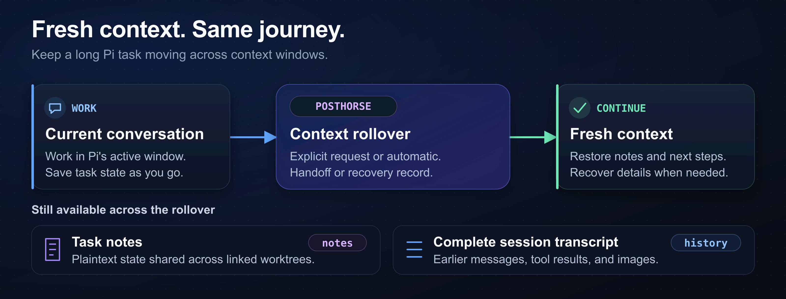

# Posthorse

Posthorse starts fresh context windows for long [Pi](https://github.com/earendil-works/pi) tasks without an automatic model-generated summary. Stock Pi already preserves the session journal and retains a recent tail during compaction; Posthorse adds explicit notes and history retrieval, with a handoff or bounded recovery record instead of the automatic summary.



## Install and start

Use Node 24.12.0 or later and Pi 1.3.0 or later. Posthorse supports official Pi and [fitchmultz/pi](https://github.com/fitchmultz/pi).

Update an older Pi installation before you install Posthorse. Run these commands:

```bash
pi install npm:pi-posthorse
pi
```

Restart Pi after installation or an update. To try Posthorse for one session, run `pi -e npm:pi-posthorse`.

Give Pi your task. For example:

> Save task state in a note. Start a fresh context window with the next steps.

## How rollover works

Posthorse can nudge the model to update task notes before rollover, then continue working. The nudge does not require `new_context` or wake an agent after its final answer. Large turns can reach rollover before the nudge.

Automatic rollover retains a safe recent-message tail using Pi's `compaction.keepRecentTokens`, alongside a bounded recovery record for discarded inputs and tool evidence. It never calls a summarization model. The model must restore notes and check live state before it continues. Optional `new_context` deliberately retains no prior messages; manual `/compact` uses Pi's normal summarization.

Safe recent-tail retention and the notes-only reminder are part of the [0.10.0 changes](CHANGELOG.md#0100). Match these docs to your installed version using the changelog; default-branch documentation may describe changes not yet published.

Recoverable history is not guaranteed model recall. See the [practical guarantees and limits](docs/context-recovery.md) for the stock-Pi comparison, search scope, checkpoints, privacy, concurrency and cost, or the [rollover reference](docs/reference.md#how-it-works) for implementation details.

## Tools

These tools are available to the model:

| Tool                        | Use                                                                                                                                                |
| --------------------------- | -------------------------------------------------------------------------------------------------------------------------------------------------- |
| `new_context({ handoff? })` | Optionally request a clean reset with no retained messages after every foreground tool succeeds. Aborted turns and failed tools prevent the reset. |
| `get_context_remaining()`   | Estimate tokens left until rollover and the configured context limit. Usage can be unknown before a model response.                                |
| `notes({ op, ... })`        | List, read, search, write, or append task notes.                                                                                                   |
| `history({ op, ... })`      | Search earlier conversation and read entries, including images. `all: true` includes this project's other sessions and nested subagent runs.       |

Expand a tool card with Ctrl+O. In fullscreen mode, click a tool card to expand it. A `new_context` card shows a request. Pi's `Compacted from … tokens` card confirms the rollover.

See [tool examples and paging details](docs/reference.md#tools).

## Settings and limits

Posthorse uses Pi's effective `compaction` settings. It has no separate settings.

| Pi setting                    | Effect                                                                                                                                                             |
| ----------------------------- | ------------------------------------------------------------------------------------------------------------------------------------------------------------------ |
| `compaction.enabled`          | Set to `false` to disable reminders and automatic rollover. `new_context` remains available.                                                                       |
| `compaction.reserveTokens`    | Automatic Posthorse rollover needs at least 10,000 tokens after this reserve. Smaller budgets use Pi's own compaction. Lower the reserve or choose a larger model. |
| `compaction.keepRecentTokens` | Approximate recent tail for automatic rollover (Pi's default: 20,000). Zero keeps no messages. Tail size shrinks when safe groups cannot fit the fresh budget.     |

Two Posthorse copies can register the same tools and compete for rollover. Keep one copy loaded. Check installed sources with `pi list`.

Multiple compaction-policy extensions can make rollover depend on load order. Enable only one.

Oversized input and some overflow or truncated responses can reach the provider before automatic recovery. Save task state in notes. Background work outside the foreground tool batch continues across rollover.

See [size limits and extension order](docs/reference.md#settings).
Check the [legacy-session details](docs/reference.md#official-pi-and-the-fork) before you move old fork sessions to official Pi.

## Update or remove

```bash
pi update npm:pi-posthorse
pi remove npm:pi-posthorse
```

Removal leaves notes and Pi session history in place. See the [installation reference](docs/reference.md#install) for Git sources.

## Data and privacy

Posthorse makes no network requests. Notes are plaintext files under `.pi/notes/`; linked Git worktrees share them. Notes for Pi-managed Git packages live outside their checkouts because `pi update` deletes untracked files there: global packages (including their descendants) use Pi's agent-directory `notes/`, and other project-local packages use the containing project's `.pi/package-notes/`, with project-local stores keyed by a full SHA-256 digest of the host and package path. Access existing checkout-local notes with this version before updating the package so they can migrate. Add `.pi/notes/` and `.pi/package-notes/` to the containing project's `.gitignore` if the notes must stay private.

History can include user messages, assistant thinking, tool arguments, errors, and images. Content you retrieve enters the context of your selected model and provider.

See [storage and privacy details](docs/reference.md#data-and-privacy).
For cost diagnosis, see the [cached-token investigation](ARTIFACTS/investigation-report.md).
It does not establish the cause of a production bill or a measured cost improvement.

## Development

See [development and host qualification](docs/development.md) for setup, tests, and releases.
See [code quality](docs/quality.md) for the required checks.

## License

[MIT](LICENSE).
